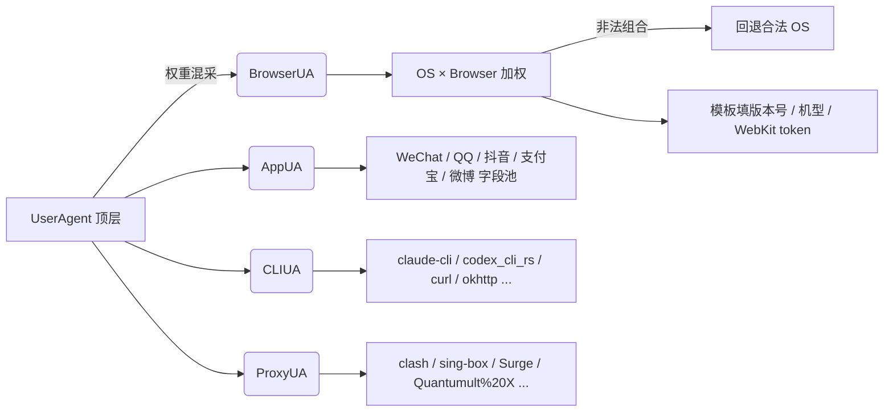
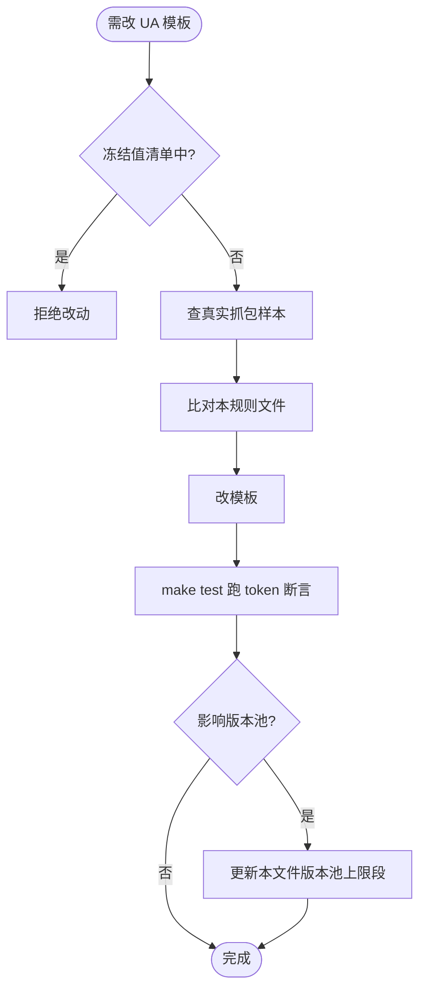

# fake/ UA 模板真实性规则

适用范围：`fake/ua_browser.go` / `ua_app.go` / `ua_cli.go` / `ua_proxy.go` 内所有模板字面值。改动模板字面值前必须比对本文件，违反 = 假货特征。

---

## 模板生成总览

---

## 冻结值清单（永不改）

| Token | 值 | 适用 | 来源 |
|---|---|---|---|
| AppleWebKit | `605.1.15` | Safari (mac/iOS) + 所有 iOS 浏览器 | Safari 11.1 起冻结 |
| Safari token (mac/iOS Firefox) | `Safari/605.1.15` | mac Safari + iOS Firefox | |
| Safari token (iOS Chrome/Edge/Opera) | `Safari/604.1` | iOS 手机 Chrome/Edge/Opera | |
| mac OS X (Chromium 系 + Safari 桌面) | `Intel Mac OS X 10_15_7` | Chrome/Edge/Opera/Safari mac | Safari 15 起冻结；下划线 |
| mac OS X (Firefox 桌面) | `Intel Mac OS X 10.15` | Firefox 桌面 | 点分；区别于下划线 |
| Mobile build | `Mobile/15E148` | 所有 iOS 浏览器手机端 | |
| Version (iOS) | `Version/18.0` | Safari + iOS Edge/Opera | iOS 26.2 起冻结 |
| Gecko (桌面 Firefox) | `Gecko/20100101` | Firefox Win/mac/Linux | |
| Gecko (Android Firefox) | `Gecko/{F}.0` | Firefox Android | trail = 版本号 |
| Version 4.0 (Android WebView) | `Version/4.0` | app 内置 WebView | 出现即 WebView |
| Chromium 后缀 | `.0.0.0` | Chrome/Edge/Opera/Samsung 桌面 + 移动 | UA Reduction；主版本可变 |
| iOS OS 版本（被冻结） | `iPhone OS 18_7` | iOS 26.2+ Safari | 真 iOS 26 仍报 18_7 |

---

## 平台 token 表

| 平台 | UA token | 备注 |
|---|---|---|
| Windows | `Windows NT 10.0; Win64; x64` | 全 Chromium / Firefox 统一 |
| macOS (Chromium/Safari) | `Macintosh; Intel Mac OS X 10_15_7` | 下划线 |
| macOS (Firefox) | `Macintosh; Intel Mac OS X 10.15` | 点分 |
| Linux | `X11; Linux x86_64` | |
| iPhone | `iPhone; CPU iPhone OS {U} like Mac OS X` | U 下划线形 (`18_4` 等) |
| iPad | `iPad; CPU OS {U} like Mac OS X` | 没有 `iPhone` 词 |
| Android (Chrome/Edge/Opera/Samsung) | `Linux; Android {N}; {model}` | model 真实机型 token |
| Android (Firefox) | `Android {N}; Mobile` 或 `Tablet` | 无机型 token |

---

## 浏览器尾标 token

| 浏览器 | 桌面 | Android | iOS |
|---|---|---|---|
| Chrome | `Chrome/{C}.0.0.0` | `Chrome/{C}.0.0.0 Mobile Safari/537.36` | `CriOS/{C}.0.0.0 Mobile/15E148 Safari/604.1` |
| Edge | `Chrome/{C}.0.0.0 Safari/537.36 Edg/{C}.0.0.0` | `... Mobile Safari/537.36 EdgA/{C}.0.0.0` | `... Version/18.0 EdgiOS/{C}.0.0.0 Mobile/15E148 Safari/604.1` |
| Firefox | `Firefox/{F}.0` | `Firefox/{F}.0` (Gecko trail = ver) | `FxiOS/{F}.0 Mobile/15E148 Safari/605.1.15` |
| Safari | `Version/18.0 Safari/605.1.15` | — | `Version/18.0 Mobile/15E148 Safari/604.1` |
| Opera | `Chrome/{C} ... Safari/537.36 OPR/{O}.0.0.0` | `... OPR/{O}.0.0.0` | `OPT/{X}.X.X Mobile/15E148 Safari/604.1` |
| Samsung | — | `SamsungBrowser/{S}.0 Chrome/{C}.0.0.0` | — |

---

## 禁组合（生成即假货特征）

- Safari on Windows / Linux / Android（早停产）
- SamsungBrowser on iOS（无 iOS 版本）
- Edge Linux 版本号 < 95（Linux 版从 95 才有）
- Chromium 桌面/移动后缀不是 `.0.0.0`

## SamsungBrowser ↔ Chromium 绑定

| SamsungBrowser | Chromium base |
|---|---|
| 24 | 117 |
| 25 | 121 |
| 26 | 125 |
| 27 | 128 |
| 28 | 130 |
| 29 | 135 |
| 30 | 140 |

**违反 = 不可能组合。SamsungBrowser 与 Chrome 不可独立随机，必须走映射表。**

---

## App 内置浏览器特殊约束

### WeChat

| 项 | iOS | Android |
|---|---|---|
| 版本号位数 | 3 段 (`8.0.61`) | 4 段 (`8.0.55.2780`) |
| hex code | `(0x{8 hex})` | `(0x{8 hex})` |
| WebKit | `AppleWebKit/605.1.15` | `Chrome/{C}.0.0.0` + `Version/4.0` (WebView) |
| 必含尾 token | `NetType/{net} Language/zh_CN` | `WeChat/arm64 Weixin NetType/{net} Language/zh_CN ABI/arm64` |
| 标志 token | `MicroMessenger/{v}` | `MicroMessenger/{v}` + `XWEB/{xweb}` + `MMWEBSDK/{date}` + `MMWEBID/{id}` |

### 抖音

- 固定 hash `BytedanceWebview/d8a21c6` 不可改
- 必含 `AppName/aweme` + `ByteLocale/zh-CN Region/CN`

### 支付宝

- `AliApp(AP/{v})` 与 `AlipayClient/{v}` 必同号
- 必含 `Language/zh-Hans`

### 微博 iOS

- 括号体下划线分隔：`Weibo (iPhone{model}__weibo__{v}__iphone__os{X.Y})`

### QQ

- Android：`V1_AND_SQ_{v}` + `QQ/{v}` + `MQQBrowser/{m}` + `TBS/{tbs}`
- iOS：`Mobile/15E148 QQ/{v}` + `MQQBrowser/{m}`

---

## CLI / SDK 拼写

| 工具 | 字面值 | 来源 |
|---|---|---|
| Claude Code | `claude-cli/{ver} (external, cli)` | 源码级确证 |
| Codex | `codex_cli_rs/{ver} ({OS} {OS_ver}; {arch}) rust` | 源码级确证；OS ∈ Macos/Linux/Windows |
| curl | `curl/{ver}` | |
| wget | `Wget/{ver}` | 注意 W 大写 |
| python-requests | `python-requests/{ver}` | |
| okhttp | `okhttp/{ver}` | 全小写 |
| Go net/http | `Go-http-client/1.1` 或 `Go-http-client/2.0` | HTTP 协议版本，非 Go 版本 |
| axios | `axios/{ver}` | |
| node-fetch | `node-fetch/{ver} (+https://github.com/bitinn/node-fetch)` | 固定 URL 后缀 |
| Postman | `PostmanRuntime/{ver}` | 驼峰，无空格 |
| Insomnia | `insomnia/{ver}` | 全小写 |
| git | `git/{ver}` | |

---

## 代理客户端拼写陷阱

| 工具 | 字面值 |
|---|---|
| Quantumult X | `Quantumult%20X/{build}` （含 URL 编码 %20） |
| Clash Meta | `clash.meta/{ver}` （含点号） |
| Surge iOS | `Surge iOS/{build}` （含空格） |
| Surge Mac | `Surge Mac/{build}` （含空格） |
| sing-box | `sing-box/{ver}` （含连字符） |
| SFA | `SFA/{ver}` （sing-box Android） |
| SFI | `SFI/{ver}` （sing-box iOS） |
| Clash | `clash` 裸 token 或 `Clash/{ver}` |
| Shadowrocket | `Shadowrocket/{build} CFNetwork/{ver} Darwin/{ver}` |
| v2rayN / v2rayNG | `v2rayN/{ver}` / `v2rayNG/{ver}` (大小写敏感) |

---

## 版本池 bump 约定

每 6 个月更新一次版本池（`fake/useragents.go` 顶部 `var` 块）：

| 池 | 上限 bump 节奏 |
|---|---|
| chromeVersions | 跟 Chrome 主版本发布（约每 4 周一版）— 每 6 个月加 6 个版本号 |
| firefoxVersions | 同上 |
| edgeVersions | 与 Chrome 同步 |
| operaVersions | 滞后 Chromium ~2 版，每 6 个月加 3 个 |
| iosVersionsU | 每年 9 月 iOS 大版本时加 |
| samsungChromiumBase | 每出 SamsungBrowser 新主版本时加映射（标官方/推断） |
| androidDevices | 旗舰新机发布时加（年度）；老机型不删（保覆盖） |

## 修改流程

改 UA 模板字面值前必须：

1. 查实样（useragentstring.com / 真实抓包）
2. 比对本表冻结值，不冲突再改
3. 跑 `make test` 确认 token 断言全过
4. 若 bump 影响 `fake/ua_*.go`，更新本文件版本池上限

---

## 参考底稿

研究报告存档（2026-06）：

- 浏览器 UA 矩阵：`a9a6e3b199e2245e5.output`
- App/CLI/代理 UA：`a995531cd828f18b2.output`
- Sub-Store UA 判定源：[sub-store-org/Sub-Store](https://github.com/sub-store-org/Sub-Store) `backend/src/utils/user-agent.js`
- Codex UA 源码：[openai/codex](https://github.com/openai/codex) `codex-rs/login/src/auth/default_client.rs`
- Claude Code UA：源码级确证（`claude-cli/{ver} (external, cli)`）
